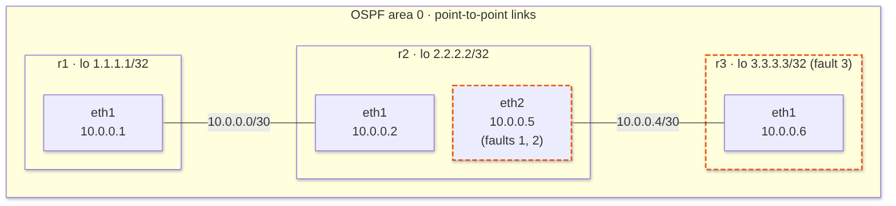

# OSPF Troubleshooting Agent

A read-only AI agent that diagnoses OSPF routing faults in a three-router lab built with [FRR](https://frrouting.org/), Docker and [Containerlab](https://containerlab.dev/). When prompted, it inspects the routers with five read-only tools and reports the cause, the evidence and a suggested fix. The repo also includes scripts that plant three known faults, and a benchmark that runs the agent against each one and records the results.

Finding the cause of a routing fault usually means logging into router after router, running show commands and comparing the outputs. This project tests whether an AI agent can do that loop safely and accurately: it can only run read-only commands, every step it takes is logged, and its accuracy is measured against faults whose cause is known. It found the planted cause in 9 of 9 scripted runs and 9 of 9 runs done by hand ([Results](#results)).



## Example run

With fault 1 planted (mismatched hello timers on the r2–r3 link), the agent is given only the symptom. It prints one line per turn, with its reason and the tools it called, then its report (evidence shortened):

```
$ .venv/bin/python -m agent.loop "r1 cannot reach 3.3.3.3 (r3's loopback). Find the cause."
Turn 1: I'll start by checking r1's routes to see whether it has a route to 3.3.3.3.  ->  routes(r1), ospf_neighbors(r1)
Turn 2: r1 has no route to 3.3.3.3, though it does have 10.0.0.4/30. Next I'll check r2's neighbors and routes.  ->  ospf_neighbors(r2), routes(r2)
Turn 3: r2 has no OSPF neighbor on eth2, which faces r3. I'll look at the config on r2 and r3.  ->  running_config(r2), running_config(r3), ospf_neighbors(r3)
Turn 4: report
Finished in 4 turns and 7 tool calls.
Cause: The OSPF adjacency between r2 and r3 is down because of a hello-interval mismatch on the r2–r3 link. r2 eth2 uses a 5s hello interval and r3 eth1 uses the default 10s. r1 therefore never learns 3.3.3.3/32.

Evidence:
- r2 `ospf_neighbors`: only 1.1.1.1 is listed, and there is no neighbor on eth2.
- r2 running-config: eth2 (to-r3) has `ip ospf hello-interval 5`.
- r3 running-config: eth1 (to-r2) has no hello-interval set, so it uses the default of 10s.
...
- I didn't read the live timers with a tool. The diagnosis rests on the configs.

Suggested fix: Make the hello intervals match on both ends of the link. Either remove `ip ospf hello-interval 5` from r2 eth2, or set `ip ospf hello-interval 5` on r3 eth1. Also check that the dead intervals agree. After that, confirm that the r2–r3 adjacency reaches Full and that r1 learns 3.3.3.3/32.
```

## How it works

### The lab

- Every lab interface, loopbacks included, is in OSPF area 0. Both links are point-to-point, loopbacks are passive, and the timers are FRR's defaults (hello 10 s, dead 40 s).
- Each router's default route is deleted at deploy (the `exec` step in `networkA/networkA.clab.yml`), so every route between routers comes from OSPF. Without it, traffic with no OSPF route would leave through the management interface, and a ping could pass while the lab was broken.
- `eth0` on each router is Containerlab's management network (172.20.20.0/24), not part of the lab.

### Faults

Each fault breaks r1's route to 3.3.3.3 in a different way. The scripts in `networkA/faults/` change the running config with `vtysh`, then check r1's routing table every 2 seconds until the route disappears, giving up after 60 seconds. Each has a matching `faultN_undo.sh`, which restores the route within a minute. None of them run `write memory`, so a redeploy also clears a fault.

| # | Plant script | What it changes | What the routers show | Time to appear |
|---|---|---|---|---|
| 1 | `fault1_hello_mismatch.sh` | `ip ospf hello-interval 5` on r2 eth2; r3 stays at 10 s | The link is up, but r2 and r3 are no longer neighbors | Up to about 40 s, when the dead timer runs out |
| 2 | `fault2_interface_shutdown.sh` | `shutdown` on r2 eth2 | r2 eth2 is admin down, with no r2–r3 neighbor | Immediate |
| 3 | `fault3_loopback_not_advertised.sh` | Removes `ip ospf area 0` from r3 lo | All neighbors are `Full`, but 3.3.3.3/32 isn't advertised | Immediate |

### The agent

`agent/loop.py` is a plain tool-use loop over the Anthropic Messages API, with no agent framework:

1. The symptom, given as a command-line argument, goes to the model with a system prompt and five tool definitions.
2. Each turn (one model call), the model either asks for one or more tool calls or writes its report.
3. Each tool call runs through `use_tool()`. Its output goes back to the model and into the step log.
4. The loop ends when the model stops asking for tools, or after 15 turns with `Maximum number of steps reached without a diagnosis.`

The agent is told only the router names, that they run OSPF, and the symptom: no topology and no list of possible faults. Its report gives the cause, the evidence and a suggested fix, or `Inconclusive` with a summary of what it found.

<details>
<summary>The full system prompt</summary>

```
You are a network troubleshooting agent for the networkA lab: three FRR routers, r1, r2 and r3, running OSPF. You will be given a problem description. Use the tools to gather information and diagnose the problem. The tools are read-only and thus you cannot change anything on the routers.

Work one check at a time. Before each tool call, log in one sentence why you are making it. Don't make assumptions about the network state, check it with the tools.

Don't try to fix the problem. When you know the cause, stop and reply in this format:
Cause: <one sentence>
Evidence: <the tool outputs that prove it>
Suggested fix: <the change a person should make>
If you can't determine the cause, reply "Inconclusive" and summarize what you found.
```

</details>

Each tool runs one fixed command inside a router container through `docker exec` (`agent/tools.py`):

| Tool | Command |
|---|---|
| `interfaces(router)` | `vtysh -c "show interface brief"` |
| `ospf_neighbors(router)` | `vtysh -c "show ip ospf neighbor"` |
| `routes(router)` | `vtysh -c "show ip route"` |
| `running_config(router)` | `vtysh -c "show running-config"` |
| `ping(router, target)` | `ping -c 2 -W 2 <target>` |

`agent/steplog.py` writes one JSON line per tool call, plus one for the report, with the time (UTC), tool, inputs, output and the model's stated reason. Calls made in the same turn share that reason. For a full example, see [the log of fault 1, run 1](agent/results/2026-10-20_2008/fault1_run1_steps.jsonl).

### Guardrails

Read-only is enforced in code, not only in the prompt:

- **No write tools.** The five tools above are the only ones, and none can change config or interface state. Asking for any other tool returns an error.
- **Fixed commands.** The model picks a tool and a router, never the command text. That's why the four show commands are separate tools: one "run any show command" tool would let the model send something like `clear ip ospf process`.
- **Inputs checked before anything runs.** The tool schemas allow only `r1`, `r2` and `r3`, and `tools.py` checks again: the router must be exactly one of the three, and a ping target must parse as an IPv4 address. Bad input goes back to the model as a tool error.
- **No shell.** Commands go to `subprocess.run` as argument lists, so input like `3.3.3.3; reboot` can't inject anything.
- **Limits.** Each command times out after 15 seconds, and the loop stops after 15 turns. The turn limit doesn't cap tool calls within a turn; the most seen was 4.
- **No approval step yet.** Nothing can change config, so there's nothing to approve. It comes with the first tool that can.

## Results

The agent found the planted cause in **9 of 9 scripted runs** and **9 of 9 earlier runs done by hand**, 3 per fault in each set. Each run used 3–5 of the 15 allowed turns and took 8–13 seconds from the first check to the report, and no tool call was rejected.

| Fault | Planted cause | Set | Cause found | Turns | Tool calls |
|---|---|---|---|---|---|
| 1 | Hello timer mismatch on r2 eth2 | Scripted | 3/3 | 4, 4, 4 | 7, 7, 7 |
| | | By hand | 3/3 | 4, 5, 5 | 7, 8, 8 |
| 2 | r2 eth2 shut down | Scripted | 3/3 | 4, 3, 4 | 8, 5, 6 |
| | | By hand | 3/3 | 4, 4, 4 | 7, 8, 8 |
| 3 | r3's loopback not in OSPF | Scripted | 3/3 | 5, 4, 4 | 7, 6, 6 |
| | | By hand | 3/3 | 5, 4, 5 | 7, 6, 7 |

Model: `claude-sonnet-5-5`. Step logs for every run: [scripted](agent/results/2026-10-20_2008/) and [by hand](agent/manual_logs/).

### Grading

Every run got the same prompt, whichever fault was planted: `"r1 cannot reach 3.3.3.3 (r3's loopback). Find the cause."` A run counts as found only if the report names the specific cause, by rules set before the runs:

- **Fault 1:** a hello/dead timer mismatch on the r2–r3 link (r2 eth2). "The adjacency is down" alone fails.
- **Fault 2:** r2 eth2 is administratively shut down. "The r2–r3 link is down" alone fails.
- **Fault 3:** r3's loopback isn't in OSPF, so it isn't advertised. "3.3.3.3 is unreachable" alone fails, and so does blaming `passive-interface lo`.

Each report's evidence was also checked against its step log, and its suggested fix against the planted fault.

### What the agent did

- Every run made at least two tool calls in one turn (up to 4), even though the prompt says "one check at a time". That's harmless with read-only tools, but it's a small example of why the guardrails are in the code rather than the prompt. The prompt was left as is so every graded run tested the same agent.
- No evidence line contradicted the step logs, and every suggested fix would have worked. Some reports also said what they hadn't checked, such as "I did not check r3's own configuration."
- It overstates history. Every report says something "never" happened, as in "r1 never learns 3.3.3.3", although the route existed until the fault was planted. The tools only show the current state.

### Limits

One fault at a time, in a three-router line, each coming down to one config line, with the same prompt every time. Three runs per fault is a small sample: it shows the agent can find these faults, not how often it would fail. Scripted runs also start seconds after the previous fault's undo, so uptime counters show what just changed; the agent remarked on it in 5 of the 9 but never blamed it. Not tested yet: two faults at once, bigger topologies, and vaguer prompts.

## How it was built

- I built it with Claude Code. From the task prompts I gave it, one task at a time, it drafted the lab, the fault scripts, the tools and their tests. `CLAUDE.md` holds the scope and rules it reads every session.
- Each task started in plan mode: I approved or cut its plan, approved its commands one by one, and ran the check myself before committing.
- I wrote the agent loop myself over two drafts, with Claude reviewing and correcting it in chat.
- Reviewing each step caught it going off track: once it edited a file without asking because auto mode was on, and once it wrote `no shutdown` in an undo script when my prompt said `shutdown`, guessing what I meant instead of asking.

## Running it yourself

All commands run from the repo root.

### Prerequisites

- **Linux, or Windows with WSL2.** Tested on WSL2 (Ubuntu). On Windows, install Docker and Containerlab inside WSL.
- **Docker** (tested with 29.8.1).
- **Containerlab** (tested with 0.81.0). Its commands need `sudo`.
- **Python 3 with `venv`** (tested with 3.14). The packages are pinned in `agent/requirements.txt`.
- **An Anthropic API key** ([how to get one](https://platform.claude.com/docs/en/get-api-key)). API calls are billed per use.

The FRR image, `quay.io/frrouting/frr:10.2.1`, is pulled automatically on the first deploy.

### Installation

1. **Clone the repo.**

   ```bash
   git clone https://github.com/DrSuriya/network-troubleshooting-agent.git
   cd network-troubleshooting-agent
   ```

2. **Deploy the lab.** This starts the containers `clab-networkA-r1`, `clab-networkA-r2` and `clab-networkA-r3`.

   ```bash
   cd networkA && sudo containerlab deploy -t networkA.clab.yml && cd ..
   ```

3. **Install the Python packages.**

   ```bash
   python3 -m venv .venv
   .venv/bin/pip install -r agent/requirements.txt
   ```

4. **Add your API key.** Create `.env` in the repo root with an editor, containing one line: `ANTHROPIC_API_KEY=sk-ant-...`.

5. **Check the lab is healthy.** OSPF takes 10–40 seconds to settle after a deploy. Then r1 should have an OSPF route to r3's loopback:

   ```bash
   docker exec clab-networkA-r1 ip route show 3.3.3.3
   # 3.3.3.3 nhid 15 via 10.0.0.2 dev eth1 proto ospf metric 20
   ```

### Diagnose a fault

Plant a fault, give the agent the symptom, then undo the fault:

```bash
bash networkA/faults/fault1_hello_mismatch.sh
.venv/bin/python -m agent.loop "r1 cannot reach 3.3.3.3 (r3's loopback). Find the cause."
bash networkA/faults/fault1_undo.sh
```

The output looks like the [example run](#example-run) above. The full trace, with every tool's output, is appended to `agent/logs/steps.jsonl`, so delete it between runs if you don't want to store logs from older runs. The other two faults work the same way (just change which fault you are planting).

### Run the benchmark

```bash
.venv/bin/python -m agent.run_faults            # each fault 3 times, about 5 minutes
.venv/bin/python -m agent.run_faults --runs 1   # quick check: each fault once
```

`agent/run_faults.py` checks the lab is healthy, then plants each fault in turn, runs the agent, saves the step log and undoes the fault, stopping if a plant or undo fails. Each batch goes to `agent/results/<date>_<time>/`, with a `results.md` that records the model, prompt and git commit, one row per run, and blank "Cause found" and "Notes" columns for grading by hand.

### Run the tests

```bash
.venv/bin/python -m pytest agent/tests
```

The 25 tests check the tool guardrails and the step log without touching the lab.

### Troubleshooting

- **No OSPF neighbors, and `eth1`/`eth2` are missing:** Docker or WSL restarted and brought the containers back without their links. Redeploy with `cd networkA && sudo containerlab deploy -t networkA.clab.yml --reconfigure && cd ..`, which also clears any planted fault.

## Directory

```
networkA/
  networkA.clab.yml     Containerlab topology: three FRR routers, two links
  r1/ r2/ r3/           Each router's frr.conf and daemons file
  vtysh.conf            Shared vtysh config, mounted into every router
  faults/               Plant and undo scripts for each fault
agent/
  loop.py               Agent loop: model calls, tool allowlist, step limit, logging
  tools.py              The five read-only tools and their input checks
  steplog.py            Append-only JSONL step log
  run_faults.py         Benchmark: plant, diagnose and undo each fault
  tests/test_tools.py   Tests for the tool guardrails and the step log
  results/              One folder per benchmark batch
  manual_logs/          Step logs of the runs done by hand
CLAUDE.md               Project rules for Claude Code sessions
```
